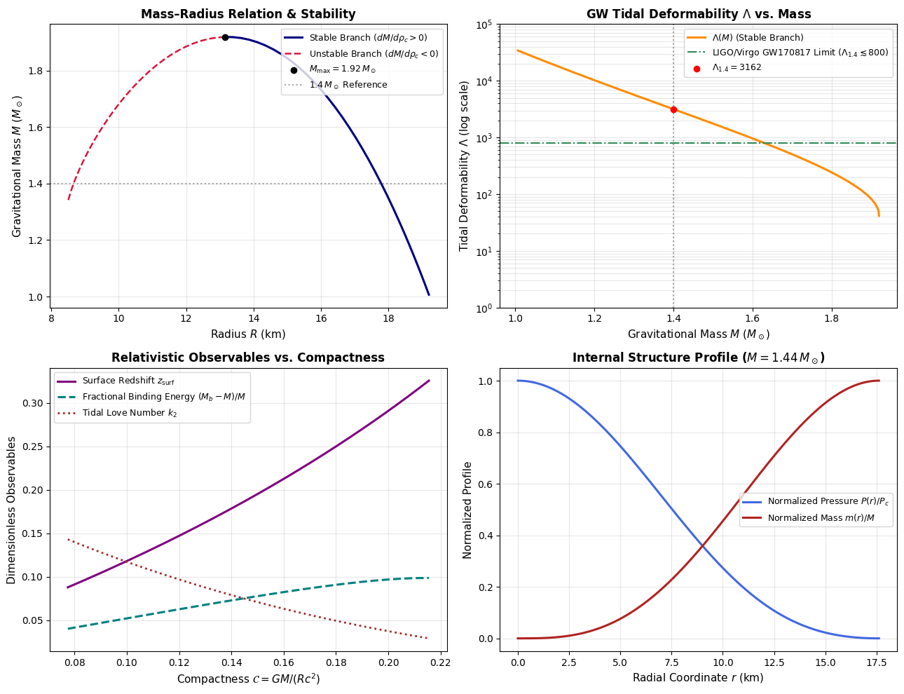

# Relativistic Neutron Star Structure & Gravitational-Wave Tidal Solver (TOV + Love)

A Python implementation of the **Tolman–Oppenheimer–Volkoff (TOV) equations** coupled with **relativistic quadrupolar tidal perturbation equations** in General Relativity. 

Beyond standard hydrostatic equilibrium, this project computes key **Gravitational-Wave (GW) observables**—specifically the second-order **Tidal Love Number ($k_2$)** and the **Dimensionless Tidal Deformability ($\Lambda$)**—which directly govern the phase evolution of Binary Neutron Star (BNS) inspirals observed by **LIGO, Virgo, and KAGRA** (e.g., GW170817).

---

## Key Features & Relativistic Observables

In strong-field gravity, Newtonian stellar structure breaks down. This solver integrates a coupled 5-dimensional system of Ordinary Differential Equations (ODEs) from the stellar core ($r \to 0$) to the surface ($P(R) = 0$) to extract:

1. **Gravitational Mass–Radius Relation ($M - R$)** and the **TOV Maximum Mass Limit ($M_{\text{max}}$)**.
2. **Radial Stability Analysis**: Separation of stable ($\frac{dM}{d\rho_c} > 0$) and unstable ($\frac{dM}{d\rho_c} < 0$) relativistic equilibrium branches.
3. **Gravitational-Wave Tidal Observables**:
   - Quadrupolar metric perturbation profile $y(r) = \frac{r H'(r)}{H(r)}$.
   - Second-order Tidal Love Number ($k_2$).
   - Dimensionless Tidal Deformability ($\Lambda$) benchmarked against the **LIGO/Virgo GW170817** constraint ($\Lambda_{1.4} \lesssim 800$).
4. **Baryonic Mass ($M_b$) & Gravitational Binding Energy ($E_{\text{bind}}$)**: Quantifying the energy reservoir available for neutrino and GW emission during core-collapse or merger remnants.
5. **Surface Gravitational Redshift ($z_{\text{surf}}$)**, **Compactness ($\mathcal{C}$)**, and **Relativistic Speed of Sound ($c_s/c$)** causality checks.

---

## Theoretical Framework

### 1. Background Spacetime Metric
The interior of a static, spherically symmetric relativistic star is described by the line element:

$$ds^2 = -e^{2\Phi(r)} c^2 dt^2 + e^{2\lambda(r)} dr^2 + r^2 (d\theta^2 + \sin^2\theta \, d\phi^2)$$

where $e^{-2\lambda(r)} = 1 - \frac{2Gm(r)}{rc^2}$.

### 2. Coupled Structure Equations (TOV + Baryonic Mass + Metric Potential)

* **Gravitational Mass Conservation:**

$$\frac{dm}{dr} = \frac{4\pi r^2 \epsilon(r)}{c^2}$$

* **Relativistic Hydrostatic Equilibrium (TOV):**

$$\frac{dP}{dr} = -\frac{G(\epsilon + P)\left(m + \frac{4\pi r^3 P}{c^2}\right)}{c^2 r^2 \left(1 - \frac{2Gm}{rc^2}\right)}$$

* **Interior Metric Potential:**

$$\frac{d\Phi}{dr} = -\frac{1}{\epsilon + P}\frac{dP}{dr} = \frac{G\left(m + \frac{4\pi r^3 P}{c^2}\right)}{c^2 r^2 \left(1 - \frac{2Gm}{rc^2}\right)}$$

* **Baryonic (Rest) Mass Accumulation:**

$$\frac{dm_b}{dr} = \frac{4\pi r^2 \rho(r)}{\sqrt{1 - \frac{2Gm(r)}{rc^2}}}$$

---

### 3. Relativistic Tidal Perturbations & Gravitational Waves

During the late inspiral of a Binary Neutron Star (BNS) coalescence, the external tidal field $\mathcal{E}_{ij}$ of one star induces a quadrupole moment $Q_{ij}$ in its companion ($Q_{ij} = -\lambda_{\text{tid}} \mathcal{E}_{ij}$). This tidal interaction accelerates the coalescence and imprints a measurable phase shift in the gravitational waveform.

Following **Hinderer (2008)** and **Damour & Nagar (2009)**, static $\ell=2$ even-parity metric perturbations are governed by a first-order Riccati equation for the logarithmic derivative $y(r) \equiv \frac{r H'(r)}{H(r)}$:

$$\frac{dy}{dr} = -\frac{1}{r}\left[ y^2 + y F(r) + Q(r) \right], \quad y(0) = 2$$

with relativistic structure coefficients:

$$F(r) = \left(1 - \frac{2Gm}{rc^2}\right)^{-1} \left[ 1 - \frac{4\pi G r^2}{c^4}(\epsilon - P) \right]$$

$$Q(r) = \left(1 - \frac{2Gm}{rc^2}\right)^{-1} \left[ \frac{4\pi G r^2}{c^4}\left(5\epsilon + 9P + \frac{\epsilon + P}{(c_s/c)^2}\right) - 6 \right] - 4\left(r\frac{d\Phi}{dr}\right)^2$$

where $(c_s/c)^2 = \frac{dP}{d\epsilon}$ is the squared relativistic speed of sound.

Matching the interior solution $y_R = y(R)$ to the exterior Schwarzschild metric at the stellar surface yields the **second-order Tidal Love Number ($k_2$)** in terms of the stellar compactness $\mathcal{C} = \frac{GM}{Rc^2}$:

$$k_2 = \frac{8}{5}\mathcal{C}^5 (1-2\mathcal{C})^2 \left[ 2 + 2\mathcal{C}(y_R - 1) - y_R \right] \times \Big\{ 2\mathcal{C}\big[6 - 3y_R + 3\mathcal{C}(5y_R - 8)\big] + 4\mathcal{C}^3\big[13 - 11y_R + \mathcal{C}(3y_R - 2) + 2\mathcal{C}^2(1 + y_R)\big] + 3(1-2\mathcal{C})^2\big[2 - y_R + 2\mathcal{C}(y_R - 1)\big]\ln(1-2\mathcal{C}) \Big\}^{-1}$$

The **Dimensionless Tidal Deformability ($\Lambda$)** directly constrained by gravitational-wave detectors is:

$$\Lambda = \frac{2}{3} k_2 \mathcal{C}^{-5}$$

---

## Equation of State (EOS)

The solver employs a relativistic polytropic Equation of State:

$$P = K \rho^\gamma, \qquad \epsilon = \rho c^2 + \frac{P}{\gamma - 1}$$

where $\rho$ is the rest-mass density, $K$ is the polytropic constant, and $\gamma$ is the adiabatic index. The modular design of `density_from_pressure()`, `energy_density()`, and `sound_speed_squared()` allows seamless integration of realistic nuclear tabulated EOS (e.g., SLy4, APR4, MPA1) via cubic spline interpolation.

---

## Numerical Implementation & Usage

### Dependencies
- `Python 3.8+`
- `NumPy`
- `SciPy` (`scipy.integrate.solve_ivp` with adaptive `RK45` and terminal event detection)
- `Matplotlib`

### Running the Solver
```bash
git clone [https://github.com/yourusername/TOV-Neutron-Star-Solver.git](https://github.com/yourusername/TOV-Neutron-Star-Solver.git)
cd TOV-Neutron-Star-Solver
pip install numpy scipy matplotlib
python tov_gw_solver.py
```

---

## Results

Running the simulation generates a comprehensive 4-panel astrophysical diagnostic figure (`tov_gw_analysis.png`):



1. **Top-Left:** Mass–Radius ($M-R$) curve distinguishing the stable equilibrium branch ($\frac{dM}{d\rho_c} > 0$) from the unstable radial collapse branch ($\frac{dM}{d\rho_c} < 0$).
2. **Top-Right:** Dimensionless Tidal Deformability $\Lambda(M)$ compared against the LIGO/Virgo GW170817 upper bound ($\Lambda_{1.4} \lesssim 800$).
3. **Bottom-Left:** Evolution of surface gravitational redshift $z_{\text{surf}}$, fractional binding energy $(M_b - M)/M$, and Love number $k_2$ as a function of compactness $\mathcal{C}$.
4. **Bottom-Right:** Normalized radial profiles of pressure $P(r)/P_c$ and enclosed mass $m(r)/M$ for a canonical $1.4\,M_\odot$ neutron star.

---

## References

1. Tolman, R. C. (1939). *Static Solutions of Einstein's Field Equations for Spheres of Fluid*. Physical Review, 55(4), 364.
2. Oppenheimer, J. R., & Volkoff, G. M. (1939). *On Massive Neutron Cores*. Physical Review, 55(4), 374.
3. Hinderer, T. (2008). *Tidal Love Numbers of Neutron Stars*. The Astrophysical Journal, 677(2), 1216.
4. Abbott, B. P., et al. (LIGO Scientific Collaboration and Virgo Collaboration) (2017). *GW170817: Observation of Gravitational Waves from a Binary Neutron Star Inspiral*. Physical Review Letters, 119(16), 161101.

---

## Author

**Parsa Arabzadeh Asadi**  
MSc in Physics  
University of Tehran
